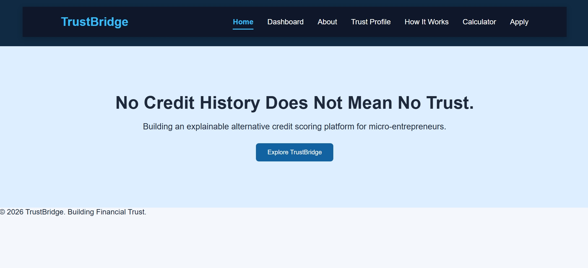
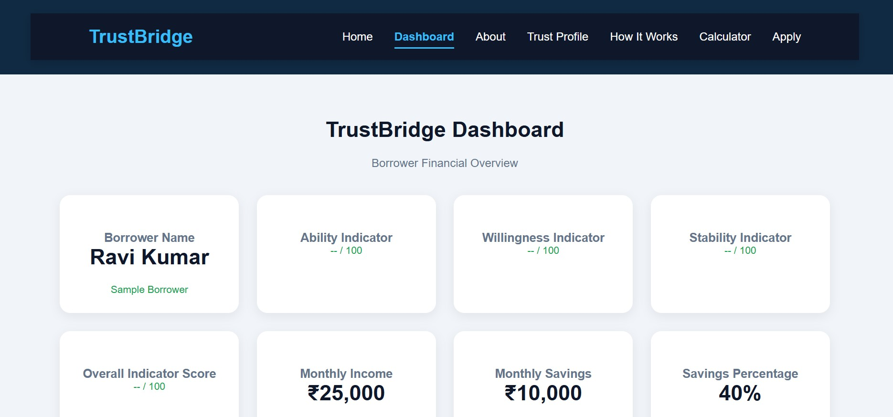
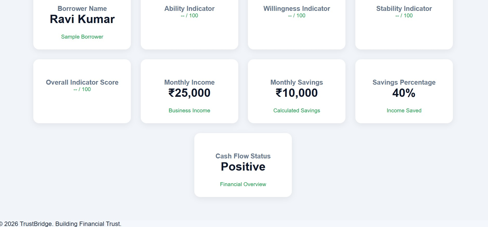
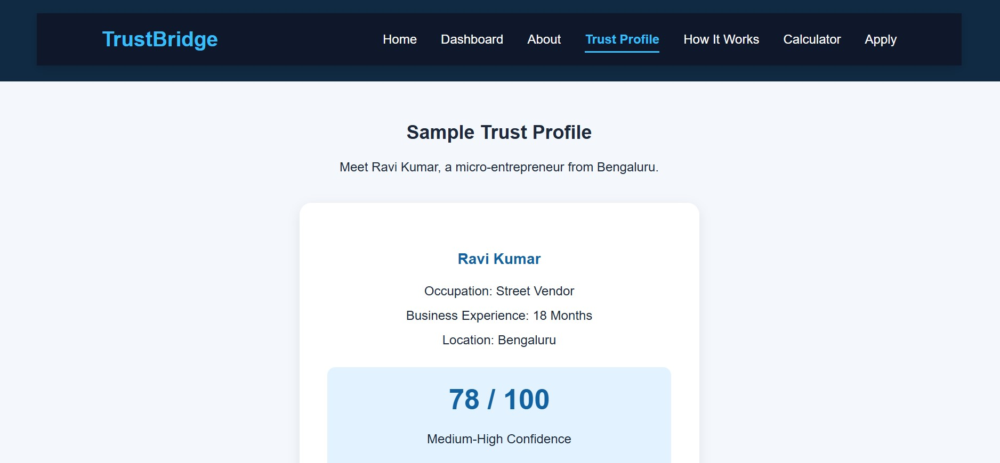
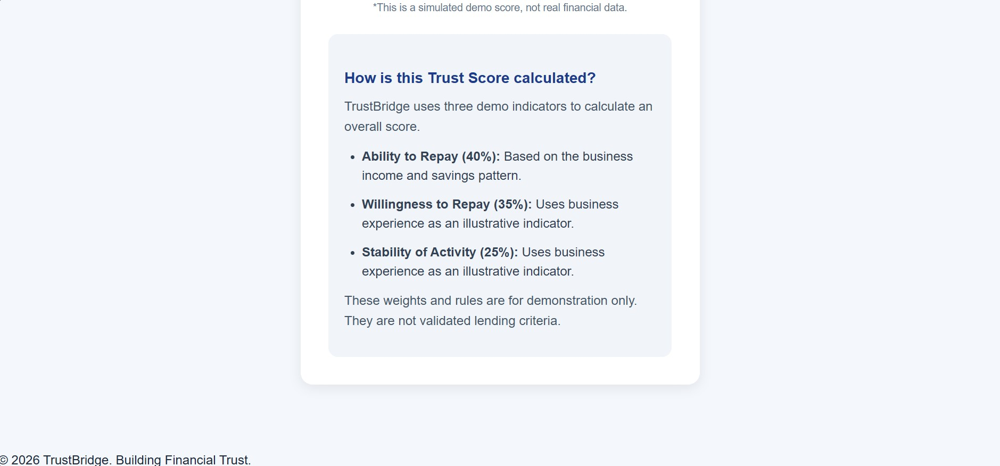
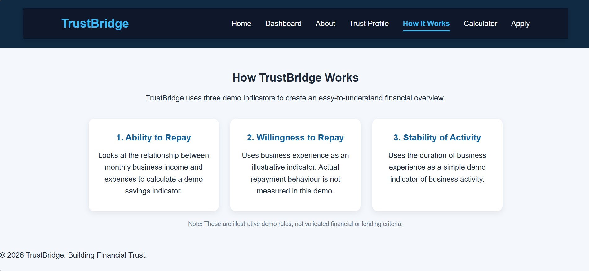
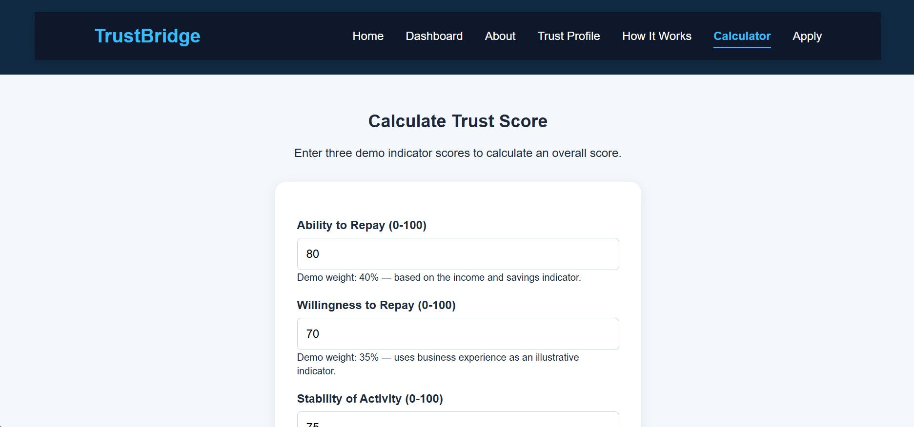
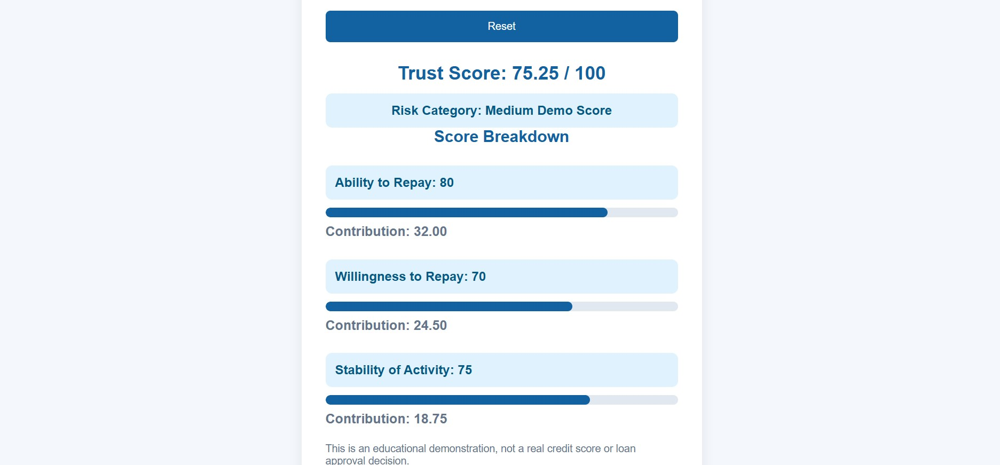
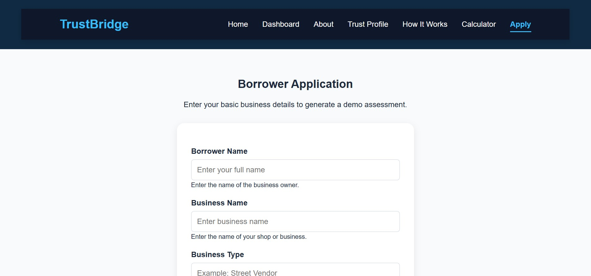
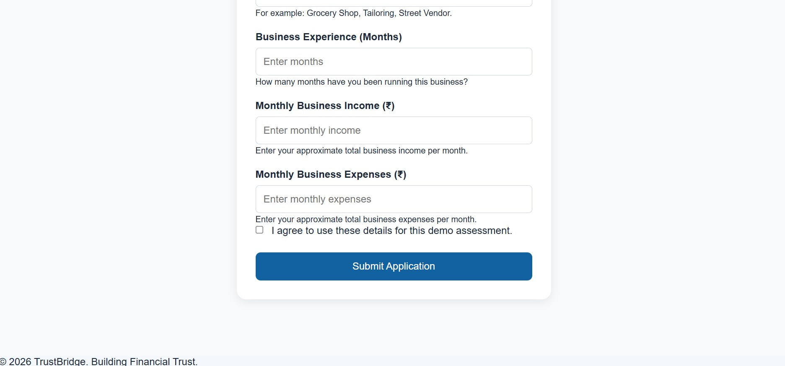

# TrustBridge

### No credit history does not mean no trust.
🌐 **Live Demo:** https://radhika002.github.io/TrustBridge/

TrustBridge is an explainable alternative credit scoring demo designed for credit-invisible micro-entrepreneurs.

It demonstrates how simple business and financial indicators can be used to generate an understandable demo score.

## Features

- Borrower application form
- Interactive dashboard
- Ability to Repay, Willingness to Repay and Stability indicators
- Weighted demo score calculator
- Transparent score explanation
- Form validation
- Responsive design for mobile and desktop

## Project Screenshots

### Home Page

### Dashboard

### Trust Profile

### How It Works

### Calculator

### Application Form

## Technologies Used

- HTML
- CSS
- JavaScript

## Demo Scoring Model

The project uses three illustrative indicators:

| Indicator | Demo Weight |
|---|---:|
| Ability to Repay | 40% |
| Willingness to Repay | 35% |
| Stability of Activity | 25% |

**Formula:**

`Demo Score = (Ability × 0.40) + (Willingness × 0.35) + (Stability × 0.25)`

## How to Run Locally

1. Download or clone this repository.
2. Open the TrustBridge folder in VS Code.
3. Open `index.html` in your browser.
4. Explore the dashboard, calculator and application form.

## Important Disclaimer

TrustBridge is an educational prototype. All borrower information and scoring rules are simulated and illustrative.

The score is not a real credit score, loan approval, or a validated assessment of creditworthiness. It must not be used to make actual lending decisions.

## Future Scope

- Backend and database integration
- Secure borrower data management
- Improved and validated scoring methodology
- Fairness and bias evaluation
- Multilingual user interface
- Human review and decision support

## Author

Developed as a learning and college project.
